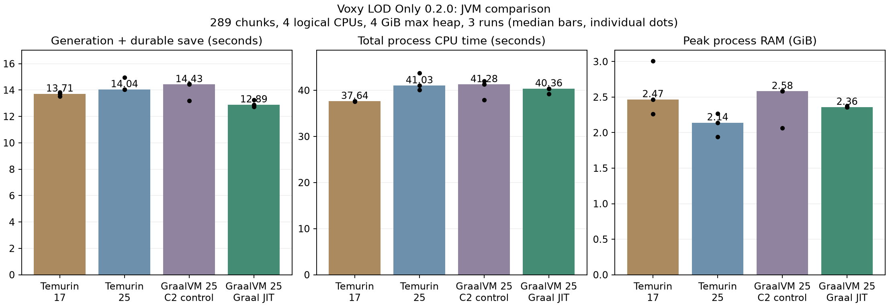

# 일반 JVM과 GraalVM 비교

Voxy LOD Only **0.2.0 최종 JAR**을 바꾸지 않고 JVM만 비교했습니다.
운영 서버·게임·설정과 저장소는 변경하지 않았습니다.

## 결과: 각 3회 중앙값

| 런타임 | 생성·저장 | CPU 누적 시간 | CPU 할당 사용률 | 최대 실제 RAM GiB | 시간 범위 |
|---|---:|---:|---:|---:|---:|
| Temurin 17 | 13.71s | 37.64s | 68.5% | 2.47 | 13.53–13.82s |
| Temurin 25 | 14.04s | 41.03s | 73.0% | 2.14 | 14.03–14.97s |
| GraalVM 25 / C2 | 14.43s | 41.28s | 71.9% | 2.58 | 13.18–14.46s |
| GraalVM 25 / Graal | 12.89s | 40.36s | 77.0% | 2.36 | 12.72–13.24s |

Graal 기본의 경과 시간 변화는 Temurin 17 대비 +6.0%,
Temurin 25 대비 +8.2%, 같은 GraalVM의 C2 대비 +10.7% 단축입니다.
양수는 Graal이 빠름, 음수는 Graal이 느림을 뜻합니다.
CPU 누적 시간은 모든 프로세스 스레드의 user+system 합이므로 빠른 경과 시간이
더 적은 CPU 연산 시간을 의미하지는 않습니다.

## 비교가 의미하는 것

- Temurin 17.0.18+8과 Oracle GraalVM의 비교에는 **Java 17 대 Java 25** 차이가 섞입니다.
- Temurin 25.0.3+9와 Oracle GraalVM Java 25.0.4.1.1은 메이저 버전이 같지만 패치와 배포판이 다릅니다.
- 같은 GraalVM에서 `-XX:-UseJVMCICompiler`만 바꾼 C2 대조군은 JDK 버전·VM 바이너리를 고정합니다.
  [Graal 공식 문서](https://www.graalvm.org/jdk25/reference-manual/java/options/)의 컴파일러 비교 방법을 사용했습니다.
  PrintFlagsFinal에서 해당 옵션이 false인 것을 확인했습니다.
- 추가 inliner/compact-header 옵션은 사용하지 않았습니다. 모두 G1GC이고 compact headers는 비활성 상태입니다.
- 25청크 요청 예열과 최소 JVM 나이 45초를 사용했습니다. 장시간 정상 상태의 최적 처리량이나
  초기 서버 부팅 속도를 측정한 것은 아닙니다. 표본 3개와 한 시드만으로 작은 차이를 확정할 수 없습니다.
- 이 결과는 전용 서버의 지형 생성·LOD 저장 작업입니다. 전체 Prominence 모드팩/TPS/클라이언트 FPS 결과가 아닙니다.

## 고정 조건과 검증

AMD Ryzen 7 7800X3D, Windows. 동일 논리 CPU [0,2,4,6], `ActiveProcessorCount=4`.
모두 `-Xms1G -Xmx4G -XX:+UseG1GC`. 실제 전체 RAM은 Windows working set으로 따로 측정했습니다.
동일 초기 월드 복사본과 시드 424242, 구조물 포함, 오버월드 X/Z 120..136의 289청크.
매회 새 JVM, 실행 순서 회전, JFR 기록 없음, 플레이어/클라이언트 작업 없음.
시간은 명령부터 생성과 저장 큐 안정화, 일반 월드 flush, Voxy WAL sync까지입니다.
설정: generationThreads=0 (CPU 4개에서 전용 작업자 3개), tile=8, inFlight=2,
cooldown=1, commitChunks=4, commitBudget=3ms, pauseAboveTickMillis=1000.
실제 제품의 기본 pauseAboveTickMillis는 45ms입니다.

12회 모두 목표 영역에 일반 청크 파일 0개를 확인했습니다.
스폰·예열 영역을 포함한 오버월드 전체의 level-0 LOD 위치 수는 모두 2,515개였습니다.
섹션 수만 같다는 것이 지형 내용 전체의 동일성 검증을 뜻하지는 않습니다.
JAR SHA-256: `58c10af86de838a6fd74a1eaab0c2c8532575f477ee2b1bd46a3cf584b7a4f28`.

## 자료와 재현

[실행별 CSV](results/jvm-runs.csv), [버전·옵션·중앙값 JSON](results/jvm-summary.json).
원시 로그/JSON: `build/optimization/20261013-044059`.
`benchmark/optimize.py --cases new-java17 new-java25 new-graal-c2 new-graal --repeats 3`
이 PC에 이미 설치된 JVM을 사용했으며 시스템 기본 JAVA나 서버 실행 스크립트를 바꾸지 않았습니다.
