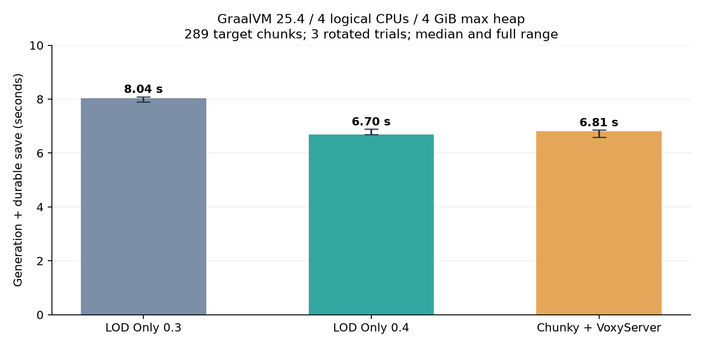

# Voxy LOD Only 0.4: 단계 측정과 대기 시간 개선

2026-10-13. 실제 운영 서버/JAR/캐시는 변경하지 않았습니다.

## 동일 조건 반복 결과

| 생성기 | 생성·저장 완료 중앙값 | CPU 누적 | CPU 할당 사용률 | 최대 실제 RAM 중앙값 | 완료 시간 범위 |
|---|---:|---:|---:|---:|---:|
| LOD Only 0.3 | 8.04s | 20.23s | 64.1% | 2.45 GiB | 7.89–8.09s |
| LOD Only 0.4 | 6.70s | 21.00s | 77.0% | 2.46 GiB | 6.69–6.89s |
| Chunky + VoxyServer | 6.81s | 21.86s | 80.2% | 2.45 GiB | 6.58–6.86s |



0.3 대비 경과 시간 16.7% 단축입니다. CPU 사용률은 늘었고 총 CPU 작업 시간은
3.8% 증가했습니다. 같은 CPU 할당 안에서 기다리는 시간을 줄였습니다. RAM 피크가
뚜렷하게 줄었다는 결과는 아닙니다. Chunky보다 중앙값이 1.7% 짧지만 세 번의 범위가
겹치므로 확실히 더 빠르다고 주장하지 않고 비슷한 수준으로 봅니다.

모두 Oracle GraalVM `C:/Java/graalvm-25.4.4.1.1+1.1/bin/java.exe`, Voxy port.9,
VoxyServer port.1, 같은 시작 월드/시드 424242, 오버월드 X/Z 120..136의 289청크입니다.
실행 순서를 회전하며 각 3회 측정했습니다. 플레이어는 없습니다. CPU는 논리 CPU
[0,2,4,6], ActiveProcessorCount=4, Xms1G/Xmx4G, G1GC입니다. JVM 최소 나이 45초와
25청크 예열을 사용했고 JFR/단계 계측/추가 Graal 플래그/동시 검증 실행은 없습니다.
최대 힙 4 GiB가 전체 프로세스 RAM 제한이라는 뜻은 아닙니다.

0.3은 자동 terrain worker=3, commit cap=16, 시간 예산=3ms입니다.
0.4는 플레이어 없는 자동 worker=4, commit cap=64, idle 시간 예산=10ms입니다.
플레이어가 있으면 CPU 여유를 남기고 기존 플레이 시간 예산 3ms를 사용합니다.
고정 worker 숫자를 지정하면 그대로 사용합니다. 총 CPU 할당과 저장 결과 조건은 같지만,
일부러 두 버전의 스케줄링 정책을 동일하게 고정한 실험은 아닙니다.

모든 실행의 LOD 위치 수는 스폰/예열 포함 2,515입니다. LOD Only의 목표 영역
일반 청크 저장은 0, Chunky의 목표 FULL 저장은 289입니다. 경과 시간은 명령부터
완료와 저장 큐 안정화/월드 flush/Voxy WAL sync까지이며 전체 compaction 시간은 아닙니다.
파일 증가량에는 스폰 영역과 WAL/테이블 상태가 섞여 있으므로 payload 압축률로 해석하지 않습니다.

이전 0.3 보고서는 Voxy port.8과 다른 실행 시점의 결과입니다. 여기서는 companion을
port.9로 통일하고 0.3/Chunky도 다시 측정했습니다. 서로 다른 실행의 수치를 섞지 않습니다.

## 실제로 바꾼 부분

- `LodOnlyConfig`, `LodOnlyManager`: 자동 worker 수가 플레이어 없는 작업에서는
  CPU 하나를 이유 없이 남기지 않습니다. 플레이어 유무는 서버 스레드에서 읽고
  배치에 전달합니다. 이후 배치에서도 플레이어 접속 여부를 다시 확인합니다.
- `LodOnlyManager`: 플레이 중 `commitBudgetMillis=3`과 별도로
  `idleCommitBudgetMillis=10`을 사용합니다. 각 section 뒤 시간 예산을 검사하고,
  완료 청크 상한은 64로 올렸습니다. 준비 window는 여전히 16청크입니다.
  idle 값도 3으로 설정하면 기존 시간 예산을 유지할 수 있습니다.
- `InMemoryGenerator`: 조명이 끝나고 출력 목록을 얻은 뒤 지형/구조물 halo 맵과
  이웃 목록 맵을 비웁니다. 기존에는 반환한 light getter가 생성기를 캡처해 임시
  이웃 전체를 반영 완료까지 붙잡았습니다. 결과 ProtoChunk와 계산된 DataLayer는 유지합니다.
  Minecraft 바이트코드에서 getDataLayerData는 저장된 조명 데이터를 읽으며 chunk getter를
  다시 조회하지 않는 것을 확인했습니다. 원래 이웃을 보관하는 기준 구현과 출력/조명을 비교했습니다.
- `GenerationTiming`: `-Dvoxy.lod.profile=true`일 때만 단계 wall/CPU와 commit 대기를 기록합니다.
  기본은 꺼져 있습니다. `benchmark/optimize.py`, `phase_report.py`에 재현 옵션/자료를 추가했습니다.

## 계측과 채택하지 않은 실험

초기 JFR/단계 탐색 `build/optimization/20261013-144318/1-v04-graal`에서는
노이즈 2.72초, 표면 0.92초, 장식 1.22초, 조명 0.32초였습니다. 작업자 셋의
노이즈 누적 CPU는 약 7.61초였습니다. 이것은 계측 실행이고 성능 표에 포함하지 않습니다.
JFR의 1,069 terrain 실행 표본도 주 계산이 노이즈/지형 작업자에 있음을 뒷받침했습니다.
실행 표본은 정확한 CPU 시간 백분율이 아닙니다.

바이옴→노이즈/표면→카버를 청크별로 결합하는 실험은 결과 비교를 통과했지만,
속도 이득을 확인하지 못해서 최종 코드에서 제거했습니다. 장식/조명 순서도 유지합니다.
`build/optimization/20261013-145504`는 이 탐색용 JAR이며 최종 artifact와 구분합니다.

`build/optimization/20261013-150501`의 후속 commit 계측에서는 cap=16에서도
cap 대기는 0회였고, 3ms 시간 예산 대기는 31회, 총 33틱/약 1.60초였습니다.
cap=64만 바꾸는 것으로는 이득이 없었습니다. 따라서 실제 수정은 idle 시간 예산을
분리하는 것까지 포함합니다. 이 중간 실행도 최종 성능 표에 포함하지 않습니다.

## 검증과 남은 범위

0.4 JAR SHA-256: `7927c72ced53420d14e6efb678320d7f0e9559bccfab5f570cd54cd275f97874`.
Voxy port.9 SHA-256: `12cb5ce5f0ef90d6e8ed095bcbdd7143f7a81286a79f6bfd78d49beffbd7228b`.

빌드와 12개 JUnit 검사, 기존 이웃 보관/직렬 구현과 새 이웃 해제/4-worker 구현의
블록·바이옴·하늘빛·블록빛 비교, 실제 remapped 서버 5회 재시작, 그래픽 LOD 경로가
통과했습니다. 상세 fixture와 modpack 검증은 [VALIDATION.md](../VALIDATION.md)에 기록합니다.

네더는 정확도 검사에서 큰 cropped patch가 다른 결과를 냈으므로 최대 8의 전체 문맥
정책을 유지합니다. 서로 다른 배치 사이의 지형 재계산, 직렬 장식/조명, 큰 묶음의
첫 결과 지연은 아직 남습니다. 모든 시드/구조물/커스텀 generator의 FULL 동등성과
실제 플레이어 부하/셰이더 픽셀/FPS 개선을 보장한 결과가 아닙니다.

## 재현 자료

최종 원시 실행: `build/optimization/20261013-151910`.
[실행 CSV](results/phase-optimization-runs.csv), [요약 JSON](results/phase-optimization-summary.json).
각 fixture의 JAR과 metadata.json에 실제 바이너리/환경/설정이 남습니다.

```powershell
$env:VOXY_TEST_JAR = 'C:\path\to\voxy-port.9.jar'
.\build\benchmark-venv\Scripts\python.exe benchmark/optimize.py --cases v03-graal v04-graal chunky-graal --repeats 3
.\build\benchmark-venv\Scripts\python.exe benchmark/phase_report.py
```
