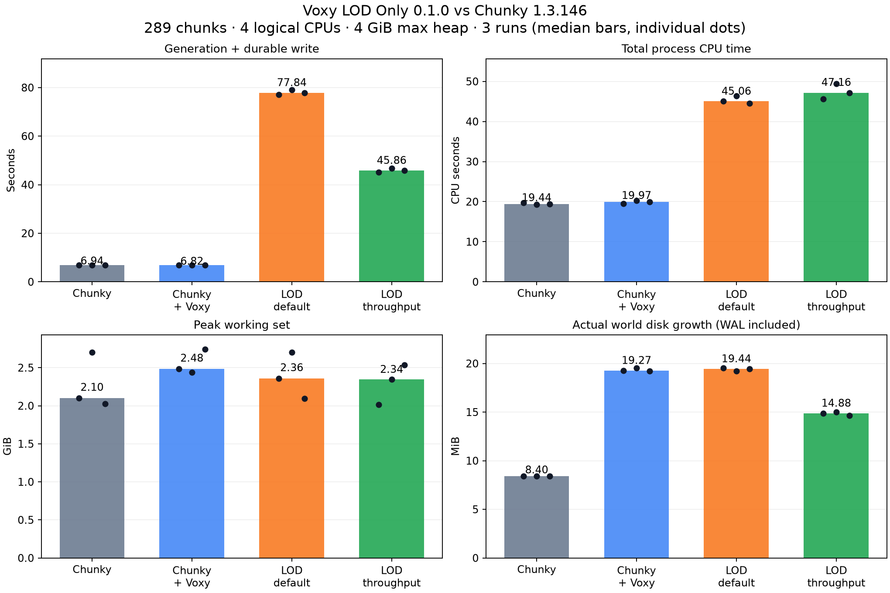

# Voxy LOD Only 용량·CPU·RAM·속도 비교

2026-10-13 KST. **현재 0.1.0은 Chunky보다 신규 지형 생성·저장이 느립니다.**
기본 설정은 약 11.2배,
대기를 최소화한 설정도 약 6.6배 오래 걸렸습니다.
현재 JAR이 남기는 디스크 사용량은 RocksDB 변경 로그 때문에 일반 월드 단독보다 큽니다.
아래 결과는 기능 구현과 성능 최적화를 구분해서 평가한 것입니다.

## 조건

- AMD Ryzen 7 7800X3D, Windows, 물리 RAM 31.58 GiB.
- 동일 논리 CPU [0,2,4,6]에 프로세스 affinity를 설정. Java에도 `ActiveProcessorCount=4`.
- Java 17.0.18, G1GC, `-Xms1G -Xmx4G`. 최대 Java 힙을 맞췄고, 실제 전체 프로세스 RAM은 따로 측정했습니다.
- Minecraft 1.20.1, Fabric Loader 0.17.2, Fabric API 0.92.6+1.20.1.
- 시드 424242, 오버월드, 구조물 포함. 청크 X/Z 120..136의 **17×17 = 289청크**.
- 동일 초기 월드를 복제하고 매번 새 JVM 사용. 다른 먼 영역 25청크를 예열한 뒤 JVM 나이 최소 35초와 저장 안정화를 기다림.
- 각 방식 3회, 실행 순서를 회전. 플레이어/네트워크/렌더링 작업 없음. 실제 운영 월드나 설치된 JAR은 변경하지 않음.
- Voxy port.8 + VoxyServer port.1. LOD Only JAR SHA-256: `78670de0d83dadc7b758a1cc252211bd62b9a80496e533b14b7f3f8e5949de49`.
- [Chunky 1.3.146 Fabric 다운로드](https://modrinth.com/plugin/chunky/version/NHWYq9at): Modrinth API의 SHA-512로 검증.
  [공식 FAQ](https://github.com/pop4959/Chunky/wiki/FAQ)는 기본 설정이 최대 속도로 동작하도록 설계되었다고 설명합니다.
  이번에는 다른 버전/로더나 C2ME를 추가하지 않았습니다.

## 신규 생성과 저장: 3회 중앙값

| 방식 | 저장까지 시간 | 청크/초 | CPU 누적 시간 | CPU 할당 사용률 | 최대 RSS | 실제 디스크 증가 |
|---|---:|---:|---:|---:|---:|---:|
| Chunky 일반 월드 | 6.94s | 41.7 | 19.44s | 70.0% | 2.10 GiB | 8.40 MiB |
| Chunky + VoxyServer | 6.82s | 42.4 | 19.97s | 73.5% | 2.48 GiB | 19.27 MiB |
| LOD Only 기본 | 77.84s | 3.7 | 45.06s | 14.6% | 2.36 GiB | 19.44 MiB |
| LOD Only 대기 최소 | 45.86s | 6.3 | 47.16s | 25.7% | 2.34 GiB | 14.88 MiB |

CPU 누적 시간은 모든 프로세스 스레드의 user+system 합입니다. CPU 4개를 모두
1초간 사용하면 4 CPU초입니다. 사용률은 이 합을 실제 경과 시간×4로 나눈 값입니다.
RAM은 200ms 간격 Windows working set 측정입니다. Java 힙 4GiB가 전체 native 메모리의
하드 제한이라는 뜻은 아닙니다. 각 실행의 RSS 변동은 CSV/그림의 개별 점을 확인하세요.

시간은 요청 명령부터 생성 완료, 수집/저장 큐가 5틱 연속 비어 있음, 일반 월드 flush와
Voxy WAL 동기화가 끝날 때까지입니다. DB compaction은 이 시간에 포함하지 않았습니다.
현재 JAR의 기본 저장 동작을 그대로 측정했기 때문입니다.

LOD 기본: cooldown 20틱, commit 1청크/틱, 평균 틱 45ms 초과 시 대기.
LOD 대기 최소: cooldown 1틱, commit 4청크/틱, 평균 틱 제한 1000ms.
하드코딩된 section 사이 3ms yield는 양쪽 모두 유지했습니다. 제품 코드를 바꾸지 않고 설정만 비교했습니다.

Chunky는 289개 요청 청크가 모두 FULL로 저장되었는지 NBT를 확인했습니다.
LOD Only는 해당 영역의 일반 청크 저장 수가 0임을 확인했습니다.
일반 생성은 필요한 주변 의존 청크도 `.mca`에 저장하므로 전체 증가량은 289개 NBT payload보다 큽니다.
작은 스폰 영역의 일반 틱/메타데이터 변화도 전체 증가량에 포함됩니다.



## 데이터 크기와 DB 변경 로그

현재 Voxy의 `RocksDBStorageBackend.flush()`는 `flushWal(true)`를 호출합니다.
이 호출은 WAL을 동기화하며, memtable을 SST로 flush하거나 compaction하는 것과 다릅니다.
LOD section과 부모 mip을 반복 갱신한 변경 이력이 로그에 남아 파일 용량을 늘립니다.
[RocksDB 공식 WAL 설명](https://github.com/facebook/rocksdb/wiki/Write-Ahead-Log-%28WAL%29),
[저장 구조 설명](https://github.com/facebook/rocksdb/wiki/RocksDB-Overview).

종료된 테스트 월드를 다시 복사해서 살아 있는 키/값을 집계하고, 모든 관련 column family를
SST flush/compact했습니다. compaction 전후 목표 영역 데이터 크기가 같음을 확인했습니다.
원래 측정 월드와 제품 JAR은 그대로 남겼습니다.

| 데이터 | 크기 중앙값 |
|---|---:|
| 요청한 289개 일반 청크의 압축 NBT payload | 2.223 MiB |
| Chunky + VoxyServer: 해당 영역 LOD 압축 키/값, 모든 mip 레벨 | 1.947 MiB |
| LOD Only 기본: 해당 영역 LOD 압축 키/값, 모든 mip 레벨 | 1.956 MiB |
| LOD Only 대기 최소: 해당 영역 LOD 압축 키/값, 모든 mip 레벨 | 1.956 MiB |

대기 최소 LOD payload는 일반 NBT payload보다 약
12.0% 작았습니다.
이 수치는 `.mca` padding/헤더, 엔티티/POI, 공통 블록·바이옴 사전, DB 인덱스·로그를 제외한
데이터 비교입니다. LOD 레코드 경계 때문에 일부 비어 있는 인접 청크 공간도 포함합니다.
Voxy의 3D 데이터와 모든 mip을 저장하므로 일반 청크 대비 수십 배 압축된다고 볼 수 없습니다.

| 방식 | compaction 후 오버월드 LOD DB 전체 |
|---|---:|
| Chunky + VoxyServer | 6.98 MiB |
| LOD Only 기본 | 6.99 MiB |
| LOD Only 대기 최소 | 7.19 MiB |

이 DB 전체 숫자에는 스폰·예열 LOD도 포함되어 있으므로, 위의 목표 영역 증가량과 직접 빼거나 비교하면 안 됩니다.
실제 배포 JAR이 자동으로 이 compaction을 수행한다는 뜻도 아닙니다.

### 재시작만으로 줄어드는 부분

원래 측정 DB를 추가로 복사해서 **수동 compact를 호출하기 전** 크기도 확인했습니다.
RocksDB를 다시 열며 WAL 복구 데이터가 SST로 정리되므로, 이번 작은 DB에서는
큰 감소의 대부분이 수동 compact 이전에 이미 일어났습니다.

| 1회차 DB 전체 | 종료 직후 | 다시 열기/정상 flush 후, 수동 compact 전 | 수동 compact 후 |
|---|---:|---:|---:|
| Chunky + VoxyServer | 27.42 MiB | 7.16 MiB | 7.18 MiB |
| LOD Only 기본 | 36.01 MiB | 6.99 MiB | 6.99 MiB |

이 값도 스폰·예열을 포함한 전체 DB입니다. 따라서 종료 직후 WAL 포함 크기만으로
LOD 데이터가 본질적으로 일반 청크보다 크다고 결론 내리면 안 됩니다.
현재 JAR의 단기 디스크 증가량, 압축된 실제 데이터, 다시 열어 정리된 DB를 각각 읽어야 합니다.

## 저장된 영역을 다시 읽기

새 JVM에서 같은 CPU/힙 제한으로 일반 FULL 청크 또는 LOD level-0 section을 읽었습니다.
LOD DB는 정리 후 재시작했고, 목표 영역의 DB 값들을 미리 전체 순회하지 않았습니다.
운영체제 파일 캐시는 비우지 않았습니다. 서버 데이터 읽기이며 클라이언트 렌더링·셰이더·FPS 검사는 아닙니다.

| 방식 | 읽기 시간 중앙값 | CPU 시간 | 최대 RSS |
|---|---:|---:|---:|
| 일반 FULL 청크 289개 | 0.729s | 2.000s | 2.04 GiB |
| 같은 영역의 LOD level-0 section | 0.077s | 0.438s | 1.97 GiB |

이 조건의 LOD 읽기는 약 9.5배 빨랐습니다.
일반 청크는 엔티티·월드 청크 구조를 복구하고, LOD는 표시용 section을 디코딩합니다.
같은 영역을 읽지만 제공하는 기능과 단위가 다릅니다. 콜드 디스크의 순수 I/O 속도나
화면이 그려질 때까지의 시간을 뜻하지 않습니다.

## 현재 구현의 개선 지점

- 가용 CPU 4개 중 실제 생성 경로가 충분히 병렬화되지 않습니다.
- 4×4 출력 tile마다 새 24×24 ProtoChunk 영역을 만들고 내부 8×8 terrain을 계산합니다.
  인접 tile에서 겹치는 지형·구조물 작업을 다시 수행합니다.
- 틱 단위 section 적용과 대기 설정이 경과 시간을 늘립니다. 대기를 줄여도
  CPU 누적 시간이 줄어들지는 않았습니다.
- 부모 mip의 여러 중간 갱신이 저장 로그에 남습니다. 저장 묶음/coalescing과
  DB flush/compaction 정책을 검토해야 디스크 사용량도 줄일 수 있습니다.

위 항목은 코드 구조와 측정 결과에서 확인한 개선 후보입니다. 개별 함수의 CPU 비중을
JFR 등으로 프로파일링해서 증명한 것은 아닙니다. 기존 캐시를 옮기거나 삭제하지 않았습니다.
현재 결과를 DH 전체 또는 다른 Voxy 버전의 성능으로 일반화하면 안 됩니다.
한 시드·한 영역·한 자원 제한·3회 표본이며 Prominence 전체 모드팩/셰이더는 대상이 아닙니다.

## 자료와 재현

- [원시 실행별 CSV](results/runs.csv)
- [중앙값과 조건 JSON](results/summary.json)
- [벡터 그래프](results/comparison.svg)
- [측정 스크립트](run.py), [종료한 복사본 분석](analyze_storage_and_read.py)
- 로컬 원시 로그/JSON: `build/benchmark/20261013-021144`.

```powershell
.\gradlew.bat remapBenchmarkJar
build/benchmark-venv/Scripts/python.exe benchmark/run.py --radius 8 --repeats 3
build/benchmark-venv/Scripts/python.exe benchmark/analyze_storage_and_read.py build/benchmark/<session>
build/benchmark-venv/Scripts/python.exe benchmark/probe_recovery.py build/benchmark/<session>
build/benchmark-venv/Scripts/python.exe benchmark/report.py build/benchmark/<session>
```

스크립트의 Fabric 서버 템플릿/JDK 경로와 테스트용 Chunky 파일을 준비해야 합니다.
Python 의존성은 psutil과 matplotlib이며 테스트 전용 venv에 설치했습니다.
원래 설치용 모드 JAR은 검증한 0.1.0과 같은 SHA-256을 유지합니다.
