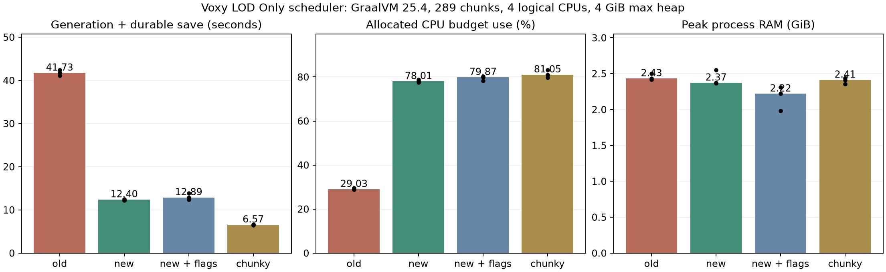

# Voxy LOD Only 0.2.0 스케줄링 개선 실측

**최종 0.2.0은 같은 GraalVM에서 3.37배 빨라졌고, CPU 누적 시간은 20.9% 줄었습니다.**

## 변경

- 독립적인 구조물 시작/참조, 바이옴, 노이즈, 표면, 동굴 계산을 제한된 작업자 풀에 분배.
- 단계마다 모든 작업의 완료를 기다림. 이웃 청크를 쓰는 장식과 독립 조명은 순차 유지.
- 생성과 서버 틱의 LOD 적용을 겹침. 적용 중인 것을 포함해 최대 2개 묶음만 보관.
- 기본 출력 묶음을 4×4에서 8×8로 늘려, 주변 생성 영역의 중복 계산 비율을 줄임.
- Voxy ID 매핑·section 적용은 기존 서버 틱 스레드에서 실행. 실제 청크가 생성되면 그 데이터를 우선함.
- 1.20.1이 공용 실행기로 보내던 노이즈·바이옴 계산도 LOD 작업에 한해서 전용 작업자 안에서 실행.
- 모든 생성 작업자에 중첩 가능한 보호 범위를 적용. 바닐라 구조물의 실제 월드 조회를 임시 영역으로 연결.
- 취소는 모든 단계/묶음을 끝낸 뒤 슬롯 재사용. 종료는 coordinator → stage pool 순서로 drain.

## 조건과 결과

같은 초기 월드 복사본, 시드 424242, 구조물 포함, 오버월드 청크 X/Z 120..136, 289청크.
Java 프로세스 affinity [0,2,4,6], ActiveProcessorCount=4, G1GC, Xms1G/Xmx4G.
25청크 예열과 최소 JVM 나이 45초 후 측정. 새 JVM을 매회 사용하고 실행 순서를 회전.
시간은 생성 완료에 더해 수집/저장 큐 안정화, 일반 월드 flush, Voxy WAL sync까지 포함.
CPU 시간은 전체 프로세스 user+system 합, CPU 사용률은 할당된 4개 CPU 용량 대비 값.
RAM은 Windows working set이며 전체 프로세스 RAM을 4GiB로 제한한 것은 아님.

기존 0.1.0도 cooldown=1, commit=4, pauseAboveTickMillis=1000인 대기 최소 설정.
수정판도 같은 값과 commitBudgetMillis=3을 사용함. 실제 제품의 기본 pause 제한은 45ms.
따라서 기존 기본 77.84초와 비교해 설정 변경 효과를 코드 개선 효과로 섞지 않음.
Chunky 비교군은 Chunky 1.3.146 + VoxyServer이며 일반 청크와 LOD를 모두 생성/저장.

| 실행 | 표본 | 생성·저장 중앙값 | CPU 누적 | CPU 할당 사용률 | 최대 RAM GiB | 평균 MSPT 샘플 |
|---|---:|---:|---:|---:|---:|---:|
| old-graal | 3 | 41.73s | 48.59s | 29.0% | 2.43 | 0.36 |
| new-graal | 3 | 12.40s | 38.45s | 78.0% | 2.37 | 0.64 |
| new-graal-flags | 3 | 12.89s | 41.39s | 79.9% | 2.22 | 0.61 |
| chunky-graal | 3 | 6.57s | 21.22s | 81.1% | 2.41 | 2.53 |
| new-graal-8cpu | 1 | 8.23s | 44.28s | 67.3% | 2.45 | 0.49 |

`new-graal-8cpu`가 있으면 그 행만 affinity [0,2,4,6,8,10,12,14], ActiveProcessorCount=8임.
그 행은 멀티코어 확장 확인용이며 4 CPU 비교군과 자원 조건이 같지 않음.
`new-graal-serial`은 worker=1/tile=4/inFlight=1, `new-graal-tile4`는 기본 병렬성에서 tile만 4임.
단일 표본의 추가 실행은 JFR profile 기록을 켠 탐색 결과이며,
계측을 끈 3회 중앙값과 같은 신뢰도로 읽거나 차이를 정확히 분해하면 안 됨.

최종 8 CPU JFR 탐색에서는 전용 terrain 작업자 7개의 실행 샘플이 모두 관찰됨.
선택한 생성 시간 구간에는 바닐라 Worker-Main 실행 샘플이 없고, 계산이 전용 작업자로 모임.
스택이 완전히 해석되지 않은 표본이 있으므로 노이즈/장식별 정확한 CPU 시간 비중은 주장하지 않음.
[최종 JFR 샘플 요약](results/scheduler-profile.json).

## GraalVM

사용한 실제 경로: `C:\Java\graalvm-25.4.4.1.1+1.1\bin\java.exe`.
`-XX:+EagerJVMCI -Djdk.graal.ShowConfiguration=info -version`으로 Enterprise compiler 활성화를 확인.
일반 JVM 모드에서 실행했고 Native Image로 Minecraft를 재구성하지 않음.
`new-graal-flags`는 기본 옵션에 `-XX:+UseCompactObjectHeaders`와
`-Djdk.graal.TuneInlinerExploration=1`을 추가한 별도 실험임.
[공식 Graal 옵션 설명](https://www.graalvm.org/jdk25/reference-manual/java/options/)에 따르면
inlining 노력은 예열과 최대 처리량 간의 절충이고, Oracle Graal의 vectorization은 기본 활성 상태임.
추가 플래그의 이득을 확인하기 전 제품이나 운영 서버 설정에 강제하지 않음.
실제 서버에서 벤치마크용 ActiveProcessorCount=4/affinity 제한을 그대로 적용할 필요는 없음.
제품 generationThreads=0은 실제 JVM이 인식하는 CPU에 맞춰 작업자를 정함.

## 검증 범위

일반 청크 저장 검사는 매 실행에 포함: 수정판 목표 영역 일반 청크 0개,
Chunky 목표 영역 FULL 청크 289개를 확인. 같은 영역 LOD section 존재도 fence에서 확인.
별도 서버 검증은 순차/병렬 결과의 블록·바이옴·두 종류 조명 일치, 실제 청크 우선,
취소/중단/재시작과 일반 저장 보존을 검사함. 상세 결과는 VALIDATION.md의 0.2.0 기록을 참고.
CPU 단계별 JFR 시간 비중은 이 표만으로 확정하지 않음. 이웃 장식/조명과 Voxy 적용은
아직 순차 구간이고, 더 큰 tile이 모든 모드팩에서 더 정확한 지형을 보장하는 것은 아님.
한 시드·한 영역·제한된 CPU/힙 조건의 전용 서버 시험이며 전체 Prominence 플레이/FPS 검사가 아님.
LOD WAL/캐시 형식을 바꾸거나 운영 저장소를 이동·삭제하지 않음.

## 자료

[실행별 CSV](results/scheduler-runs.csv), [요약 JSON](results/scheduler-summary.json).
원시 fixture/로그/메타데이터: `build/optimization/20261013-035759`, `build/optimization/20261013-042550`, `build/optimization/20261013-043323`.
각 metadata.json에 실제 JAR SHA-256, JVM 옵션, 설정, CPU affinity가 기록됨.
수정판 표는 현재 JAR SHA-256 `58c10af86de838a6fd74a1eaab0c2c8532575f477ee2b1bd46a3cf584b7a4f28`와 일치하는 실행만 포함함.
재현: `benchmark/optimize.py --cases old-graal new-graal new-graal-flags chunky-graal --repeats 3`.
기존 0.1 JAR은 `build/optimization/baseline-0.1.0.jar`, 수정 JAR은 `build/libs/VoxyLodOnly-0.2.0+1.20.1.jar`.
벤치마크의 공통 Fabric 템플릿과 Chunky 파일, `--base`의 초기 월드 및 psutil/matplotlib 환경이 필요함.
